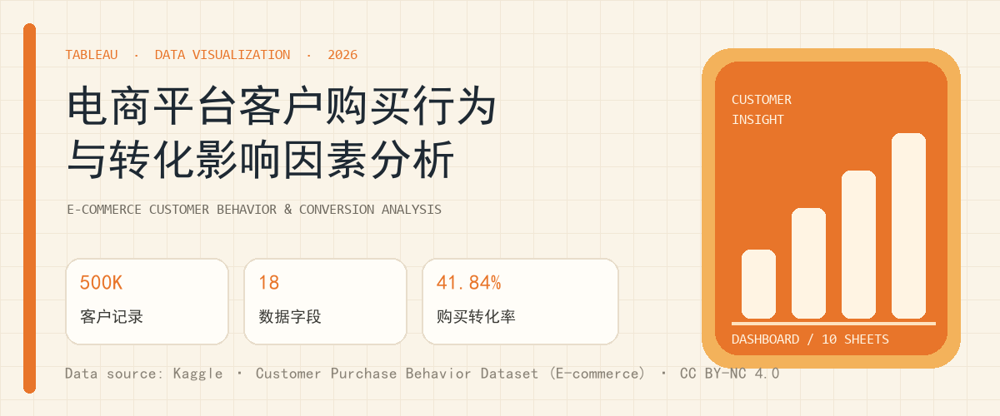
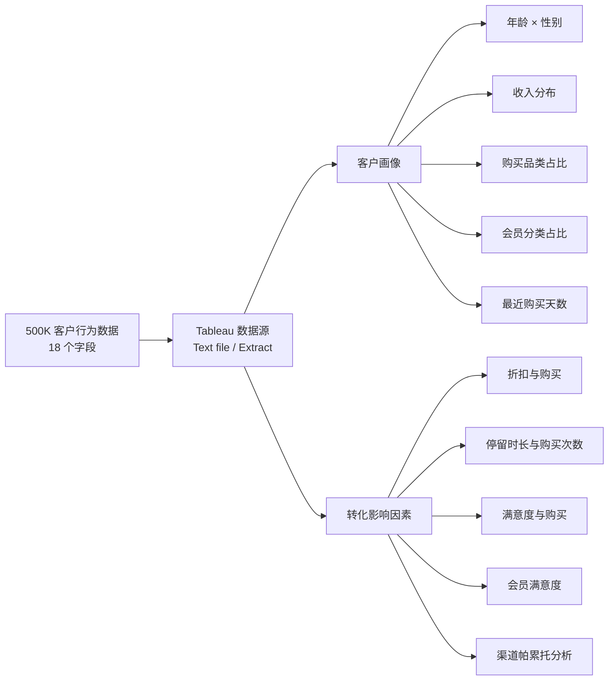

# 电商平台客户购买行为与转化影响因素分析




> 基于 50 万条电商客户购买行为记录，使用 Tableau 构建“客户画像 + 购买转化影响因素”分析仪表板。  
> A Tableau dashboard project analyzing customer profiles and purchase conversion drivers on a 500K-row e-commerce dataset.

---

## 中文简介

本项目以电商平台的客户购买行为数据为对象，围绕两个问题展开：

1. **客户是谁？** 从年龄、性别、收入、会员等级、常用设备、地区、购买品类和最近购买时间等维度构建客户画像。
2. **什么因素与购买转化相关？** 对比折扣、网站停留时长、满意度、忠诚度计划、会员等级和获客渠道与 `PurchaseStatus` 的关系。

工作簿包含 **10 张工作表** 和 **1 个纵向仪表板**，采用橙色主题，左侧为“客户画像”，右侧为“转化影响因素”，并通过 KPI、分布图、环形图、帕累托图和满意度对比图形成完整的分析叙事。

原始 50 万行 CSV **不随仓库分发**，因为文件约 57 MB，且数据集采用 **CC BY-NC 4.0（署名—禁止商用）** 许可。仓库提供 5,000 行样例、数据字典、下载说明和可移植的 `.twb` 工作簿。

## English Overview

This project explores a 500,000-row e-commerce customer purchase behavior dataset in Tableau. It builds a customer profile view (age, gender, income, membership, device, region, category, recency) and a conversion view (discounts, time on site, satisfaction, loyalty, segment and referral source).

The repository contains the Tableau workbook, a 5,000-row sample, a data dictionary, project documentation and setup notes. The full dataset is not redistributed; it can be downloaded from Kaggle under **CC BY-NC 4.0**.

---

## 仪表板结构



仪表板采用固定 **1000 × 1800** 纵向画布，顶部为项目标题与“客户画像 / 转化影响因素”分区，底部汇总关键指标。

## 分析模块

| 模块 | 工作表 | 主要分析内容 |
|---|---|---|
| 客户画像 | 客户年龄性别比 | 年龄分组 × 性别，观察客户结构 |
| 客户画像 | 收入分布 | 年收入分组，识别主要收入区间 |
| 客户画像 | 最常购买品类占比 | Fashion、Kitchen、Electronics 等品类占比 |
| 客户画像 | 会员分类占比 | Regular、Premium、VIP 三类会员结构 |
| 客户画像 | 最近购买天数分布 | `LastPurchaseDaysAgo` 分布，观察活跃度 |
| 转化影响因素 | 折扣与购买 | `DiscountsAvailed` 与 `PurchaseStatus` 的关系 |
| 转化影响因素 | 停留与购买次数 | 网站停留时长分组与购买次数 |
| 转化影响因素 | 会员满意度 | 会员等级与满意度评分 |
| 转化影响因素 | 满意度与购买 | 满意度 1–5 分对应的购买转化 |
| 转化影响因素 | 帕累托分析 | 按获客渠道统计购买次数并计算累计占比 |

## 关键发现

- **整体购买转化率为 41.84%**：500,000 条记录中 209,177 条 `PurchaseStatus = 1`。
- **忠诚度计划与更高转化相关**：会员转化率 **46.04%**，非会员 **37.61%**，相差约 **8.4 个百分点**。
- **满意度与转化呈单调上升**：满意度 1 分转化率 **27.20%**，5 分 **51.98%**，接近翻倍。
- **VIP 并不必然高转化**：本数据中 VIP 转化率 **37.76%**，低于 Regular 的 **44.26%** 和 Premium 的 **43.23%**，提示“高等级 = 高转化”的假设需要谨慎。
- **单一渠道/设备/品类差异有限**：各获客渠道、设备类型和品类的转化率差异大多在 2 个百分点以内；网站停留时长与购买状态的相关系数仅约 **0.065**，不能单独解释转化。

> 以上均为本数据集上的描述性结果，不代表因果关系；数据集可能为模拟/合成数据，结论仅用于学习与分析展示。

## 数据说明

| 项目 | 内容 |
|---|---|
| 数据名称 | Customer Purchase Behavior Dataset (E-commerce) |
| 数据规模 | 500,000 行 × 18 列 |
| 数据质量 | 无缺失值、无完全重复行 |
| 目标变量 | `PurchaseStatus`（1 = 购买，0 = 未购买） |
| 金额单位 | 美元（AnnualIncome） |
| 数据来源 | [Kaggle](https://www.kaggle.com/datasets/gauthamvijayaraj/customer-purchase-behavior-dataset-e-commerce/data) |
| 数据许可 | **CC BY-NC 4.0**（署名—禁止商用） |
| 仓库内数据 | 仅 5,000 行样例；完整 CSV 需自行下载 |

字段清单、取值范围和样例说明见：

- [data/README.md](data/README.md)
- [docs/数据字典.txt](docs/数据字典.txt)

## 仓库结构

```text
.
├── README.md
├── LICENSE
├── NOTICE
├── CITATION.cff
├── CHANGELOG.md
├── .gitignore
├── .gitattributes
├── 电商平台分析.twb
├── assets/
│   └── banner.png
├── data/
│   ├── README.md
│   └── sample/
│       └── customerData_sample_5000.csv
└── docs/
    ├── 项目说明.docx
    ├── 数据字典.txt
    └── GitHub发布信息.txt
```

## 如何运行

1. 安装 **Tableau Desktop 2024.1 或更高版本**（工作簿 XML 版本为 18.1）。
2. 从 [Kaggle 数据页](https://www.kaggle.com/datasets/gauthamvijayaraj/customer-purchase-behavior-dataset-e-commerce/data) 下载 `customerData_500k.csv`。
3. 将文件放到仓库的 `data/` 目录，确保路径为：

   ```text
   data/customerData_500k.csv
   ```

4. 双击根目录的 `电商平台分析.twb` 打开工作簿。
5. 如果 Tableau 提示找不到数据源，选择 **Data → Edit Connection**，把连接指向 `data/customerData_500k.csv`；`Text file` 连接的分隔符为逗号，字符集为 UTF-8，首行为表头。
6. 如果只需要预览工作簿结构，可将 `data/sample/customerData_sample_5000.csv` 重命名/复制为 `data/customerData_500k.csv`，但结果只代表样例数据，不代表完整数据集。

> 工作簿中的 Extract 已禁用，主要使用 CSV 文本连接；因此不需要额外的 `.hyper` 文件。  
> `.twb` 中的连接路径已改为相对路径 `data`，请保持工作簿位于仓库根目录、数据位于 `data/` 目录。

## 数据质量与分析口径

- `PurchaseStatus` 为二元目标变量，转化率 = `PurchaseStatus` 的均值。
- `AnnualIncome` 单位为美元；`TimeSpentOnWebsite` 单位为分钟。
- 年龄分组：18–24、25–34、35–44、45–54、55+。
- 收入分组：<4 万、4–7 万、7–10 万、10–15 万、>15 万美元。
- 停留时长分组：<3 分钟、3–8 分钟、>8 分钟。
- 上述分组与工作簿中的计算字段一致，详见 [docs/数据字典.txt](docs/数据字典.txt)。

## 许可与引用

- **本项目原创内容**（Tableau 工作簿、README、说明文档、样例整理）：[MIT License](LICENSE)，Copyright © 2026 郭子宁。
- **原始数据集**：**CC BY-NC 4.0**，版权归原作者所有；不得用于商业用途。仓库中的 5,000 行样例同样遵循该许可。
- 数据来源：Gautham Vijayaraj. *Customer Purchase Behavior Dataset (E-commerce)*. Kaggle.
- 引用信息见 [CITATION.cff](CITATION.cff) 和 [NOTICE](NOTICE)。

## 作者

**郭子宁**  
数据可视化 / Tableau 学习作品  
2026 年 10 月

如果这个项目对你有帮助，欢迎 Star 或提出 Issue。
